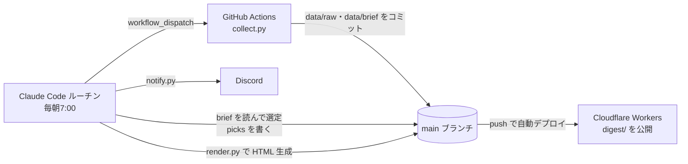

# Tech Digest

毎朝の技術ダイジェストを自動で作るツールです。AI・フロントエンド・バックエンド・インフラ・OSSの情報を集め、Claude が「今日読むべきもの」を選んで要約し、Webページにして Discord に届けます。

OSSや技術情報を追うのを毎日の習慣にしたかったものの、自分で情報源を巡回する時間はとれなかったので、「集める・選ぶ・届ける」を自動化しました。手元のPCを起動していなくても毎朝届くように、すべてクラウドで動かしています。

**公開ページ:** https://tech-digest.taiki00wo.workers.dev/

## 何が届くか

毎朝7時（JST）に Discord にリンクが1本届きます。

| | 日刊（日〜金） | 週刊（土） |
|---|---|---|
| 流れ | 今日の全体像を1文で | 今週の全体像＋流れ3つ |
| 記事 | **今日の3本**（読む順） | **今週のベスト5**（日刊で紹介済みのものは除く） |
| OSS | 急上昇リポジトリ 0〜1件 | 今週のOSS 3件（週間スター増分順）＋README からの深掘り 1件 |
| その他 | ウォッチ中のリポジトリのリリース（1行ずつ） | 登壇スライド 3本・リリース・見出し 10本・未読の「あとで読む」 |

- 各記事には「なぜ読むか」「読むと何がわかるか」と、読了時間の目安が付きます。
- 記事の ☆ を押すと「あとで読む」に保存され、`/bookmarks` で一覧できます（ブラウザに保存）。

## 仕組み



1. **収集（GitHub Actions）:** `collect.py` が各情報源と GitHub API から集め、`data/raw/日付.json` と、Claude が読む用の圧縮版 `data/brief/日付.md` を作ってコミットします。
   - Claude のクラウド環境からは GitHub API が自分のリポジトリにしか使えないので、収集だけ Actions で行っています。
   - 起動はルーチンが API で行います（GitHub の定時実行は数時間遅れることがあるため使っていません）。
2. **選定・要約（Claude）:** ルーチンが [`TASK.md`](TASK.md) の手順に従って brief を読み、`data/picks/日付.json` に「今日の3本」などを書きます。
3. **公開:** `render.py` が `digest/` に HTML を作ってpushし、Cloudflare Workers が自動でデプロイします。
4. **通知:** `notify.py` が公開ページのリンクを Discord に送ります。

## 情報源

| 種類 | 情報源 |
|---|---|
| 記事 | Hacker News（100pt以上の上位）/ Zenn / Qiita / はてなブックマーク テクノロジー |
| 公式ブログ | OpenAI / Hugging Face / Vercel / Cloudflare / GitHub / web.dev / AWS Architecture Blog |
| 個人・専門ブログ | LWN.net / Marc Brooker / Brendan Gregg / Trail of Bits / Julia Evans |
| 登壇スライド | Speaker Deck（技術カテゴリ） |
| OSS | GitHub API（新着人気リポジトリ＋記事で紹介されたリポジトリ。スター数を毎日記録して増分を計算） |
| リリース | `config.json` の `watch_repos`（Next.js / React / TypeScript / Vite / Hono / Claude Code など） |

## ファイル構成

```
collect.py      収集（記事・OSS・リリース）→ data/raw/・data/brief/
oss.py          GitHub API まわり（急上昇・リリース・README）
render.py       data/ から digest/ の HTML を生成（--all で全日分を作り直す）
notify.py       Discord に送信（Webhook は環境変数 DISCORD_WEBHOOK_URL）
TASK.md         ルーチンが毎朝従う手順（選定基準・出力形式）
config.json     情報源・件数・カテゴリ・ウォッチ対象・読者の技術スタック
wrangler.jsonc  Cloudflare Workers の設定（digest/ を静的配信）
.github/workflows/collect.yml   収集用の GitHub Actions

data/raw/       収集結果（そのままの形）
data/brief/     Claude が読む用の圧縮版（紹介済みは除外）
data/picks/     Claude が選んだ結果
data/seen.json  既出記事の記録（14日分）
data/stars.json リポジトリのスター数の履歴（増分の計算用）
digest/         公開する HTML
```

外部ライブラリは使っていません（Python 3 の標準ライブラリだけで動きます。3.13・3.14 で動作確認）。

## 設定（`config.json`）

| キー | 内容 |
|---|---|
| `site_url` | 公開ページのURL（Discord に送るリンクに使う） |
| `limits` / `hackernews_min_score` | 情報源ごとの取得件数、HN の最低スコア |
| `rss_feeds` | 追加の RSS / Atom フィード（`limit` で件数を個別に指定できる） |
| `categories` | 記事の自動分類のキーワード |
| `watch_repos` | リリースを見るリポジトリ。`owner/repo:接頭辞` でモノレポのタグを絞れる（例: `cloudflare/workers-sdk:wrangler@`） |
| `reader_profile` | 読者の技術スタック、日刊・週刊の件数、週刊の曜日（`weekday`: 月=0 … 土=5） |

選び方や書き方そのものを変えたいときは [`TASK.md`](TASK.md) を編集します。

## 自分で動かす場合

1. このリポジトリを fork する。
2. **Cloudflare:** Workers & Pages → Create → リポジトリを接続（Build command は空、Deploy command は `npx wrangler deploy`）。発行された URL を `config.json` の `site_url` に入れる。
3. **Discord:** チャンネルの設定 → 連携サービス → ウェブフック で URL を発行する。
4. **Claude Code のクラウド環境（claude.ai/code）:**
   - 環境変数に `DISCORD_WEBHOOK_URL=...` を入れる。
   - Network access を Custom にして、情報源のドメイン・`discord.com`・自分の公開ページのドメインを許可する（または Full）。
   - Claude の GitHub App に、このリポジトリへのアクセスを許可する。
5. **ルーチン:** 上の環境とこのリポジトリで、毎朝のルーチン（例: cron `0 22 * * *` = 7:00 JST）を作る。指示は「TASK.md を読み、その手順を上から順にすべて実行する」とする。
6. `TASK.md` の中のリポジトリ名（`taiki00wo/tech-digest`）と読者の技術スタックを自分用に書き換える。

## ローカルで試す

```bash
python3 collect.py   # 収集（GITHUB_TOKEN があれば GitHub API のレート制限が緩くなる）
python3 render.py    # 最新日の HTML を生成（要約がない日は収集結果のスコア上位を表示）
DIGEST_DATE=2026-10-03 python3 collect.py   # 日付を上書き（土曜にすると週刊の brief を作る）
python3 notify.py --dry-run                 # Discord に送る内容を表示するだけ
```

## 注意

- 要約は記事のタイトル・概要・スコアから書いています（本文は取得していません）。細かい内容は元の記事で確認してください。
- 「あとで読む」はブラウザの localStorage に保存されます。別のブラウザやドメインでは見えず、閲覧データを消すと消えます（一覧ページで書き出し・読み込みができます）。
